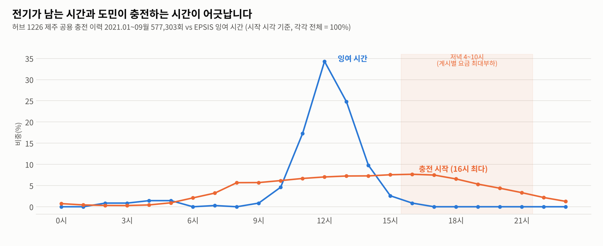
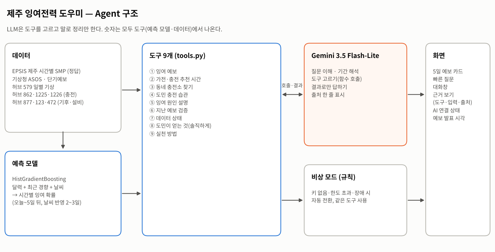
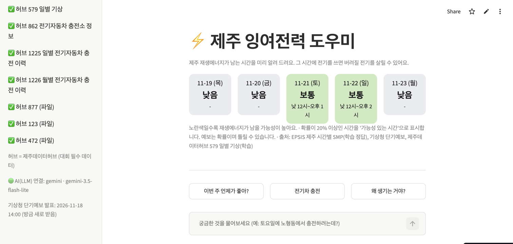
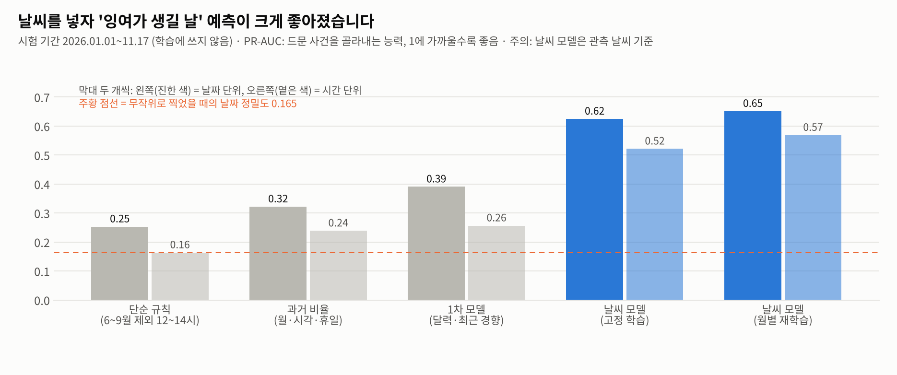

# 결과 설명자료 — 제주 잉여전력 도우미 (AI Agent)

> 제주 재생에너지가 남는 시간을 며칠 앞서 알려 주고, 도민이 그 시간에 전기를 쓰도록 돕는 AI Agent
> 작성 기준일: 2026-11-18 · 숫자는 모두 `reports/report.md`, `reports/metrics.json`, 도구 실행 결과에서 옮겼습니다.

---

## 1. 문제 정의

### 1-1. 무엇이 문제인가
- 제주는 태양광·풍력이 빠르게 늘었습니다. 허브 123 기준 태양광은 **1,998곳 711MW**로, 2018년 168MW에서 4배 넘게 늘었습니다. 허브 472 기준 풍력은 **25곳 419MW**입니다.
- 그래서 봄·가을 맑은 날 한낮에는 전기가 남아 **발전기 출력을 줄이는 출력제어**가 생깁니다.
  - 제주는 2023년 한 해 **181회** 출력제어를 했고, 2022년보다 약 37% 늘었습니다 (해줌, 벤처스퀘어 2024 보도).
  - 한국전력거래소 공개 기록으로 직접 세어 보면, 제주 **풍력**은 2021년 1월~2024년 5월에 **336일, 약 73,224MWh**를 출력제어로 버렸고(2023년 한 해 26,197MWh), **태양광**도 2021년 10월~2024년 6월에 125일 출력제어를 했습니다. 풍력 출력제어량의 93%가 오전 10시~오후 4시였습니다(팀원 B가 받은 공공데이터포털 15132422).
  - 2022년 9월~2024년 3월 제주 출력제어 분석에서는, 화력발전 최소출력을 낮추는 것만으로 줄일 수 있는 양이 누적 출력제어의 17%(약 5,800MWh)였습니다 (기후솔루션, 2025-10-31). 버려진 전기가 수만 MWh 규모라는 뜻입니다.
- 2024년 6월부터 제주에는 **재생에너지 입찰제도와 실시간시장**이 정식 시행됐습니다 (파이낸셜뉴스 2026-09-25). 그 뒤로는 강제 출력제어 대신 **가격으로 출력이 조정**되고, 전기가 남으면 제주 전력시장 가격(SMP)이 **0원 이하**로 떨어집니다. 이 서비스가 'SMP 0원 이하'를 잉여 신호로 쓰는 이유이고, 정답 데이터를 2024-06-01부터 쓰는 이유입니다.
- 2026년 3월에는 제주 전 지역의 계통관리변전소 지정이 해제되어, 새 재생에너지 발전소의 연결 검토가 다시 시작됐습니다 (메트로신문 2026-03-31). 앞으로 남는 시간은 더 늘어날 수 있습니다.
- 2024-06-01 ~ 2026-11-17(900일) 동안 제주 SMP가 0원 이하였던 시간은 **347시간(127일)**이었습니다.
  - 월별로 보면 **3월(전체 날의 48%)**, 4월(33%), 11월(26%)에 많고, **6~9월은 거의 없습니다**(0~3%).
  - 시간대로 보면 잉여 시간의 약 **91%가 오전 10시~오후 3시**에 몰립니다.


- 반대로 도민은 **남는 시간과 반대로** 전기를 씁니다. 허브 1226(2021.01~03, 39,225건)을 보면 제주 공용 충전기에서 충전을 가장 많이 시작하는 시각은 **16시**입니다.
  - 저녁 4~10시(계시별 요금의 최대부하 시간)에 시작한 충전이 **34%**입니다.
  - 잉여가 잘 생기는 오전 10시~오후 3시에 시작한 충전은 **35%**입니다.



### 1-2. 누구를 위한 것인가
| 사용자 | 얻는 것 |
|---|---|
| 제주 도민 (IT 비전문가, 어르신 포함) | "언제 빨래·충전하면 좋아?"에 쉬운 말로 답을 받음 |
| 전기차 운전자 | 잉여 시간 + 동네 충전소(급속 여부, 2022년 대기·관광객 비중)를 한 번에 확인 |
| 제주빅데이터센터 | 허브 데이터를 도민 행동과 연결하는 서비스 사례, 예보 기록을 쌓아 검증 가능 |

### 1-3. 솔직하게 밝히는 전제
- 일반(누진제) 가정은 **쓰는 시간만 옮겨서는 지금 당장 요금이 달라지지 않습니다.** 에이전트도 이렇게 답합니다.
- 금전 이득은 **계시별 선택요금제 가입 가구**(2021년 9월부터 선택 가능)와, 제주도가 추진 중인 **'제주형 전기요금제'가 시행된 뒤**에 생깁니다. 제주형 요금제는 아직 시행 전입니다.
- 그래서 이 서비스의 1차 목표는 **"버려지는 재생에너지를 줄이는 행동"을 쉽게 만드는 것**이고, 요금 이득은 조건이 맞을 때만 안내합니다.

---

## 2. 해결 방법 한눈에 보기



1. **정답 정의:** 제주 시간별 SMP가 0원 이하인 시간 = 잉여전력 시간
2. **예측:** 달력·최근 경향·날씨(관측/예보)로 앞으로 5일의 시간별 잉여 확률을 계산
3. **Agent:** 질문을 이해해 알맞은 도구를 부르고, 도구 결과에 있는 사실만으로 쉬운 말로 답함

---

## 3. Agent 구조

### 3-1. 처리 흐름 (Workflow)
1. **질문 받기:** 화면 대화창. 같은 대화의 최근 3번 질문·답변을 함께 넘겨 "그럼 거기는?"과 같은 이어지는 질문을 이해합니다.
2. **날짜 맥락 넣기:** 질문할 때마다 오늘 날짜, 이번 주·다음 주 범위, 예보 가능 범위(오늘~5일 뒤)를 지침에 넣습니다.
3. **도구 선택(LLM):** Gemini 3.5 Flash-Lite가 함수 호출(function calling)로 필요한 도구와 인자를 고릅니다. 예: 기간 → `start`·`days`. 한 질문에 최대 6단계까지 도구를 이어 부릅니다.
4. **도구 실행(코드):** 예측 모델과 허브·공공데이터를 읽어 JSON으로 돌려줍니다.
5. **답변 작성(LLM):** 도구 결과에 있는 숫자·날짜·장소만 써서 3~6문장으로 답하고, 출처를 한 줄로 붙입니다.
6. **근거 보기:** 화면에서 어떤 도구를 어떤 입력으로 불렀는지, 결과 표·그래프와 출처를 펼쳐 볼 수 있습니다.

### 3-2. 판단 및 자율 수행 범위
| Agent가 스스로 하는 것 | Agent가 하지 않는 것 |
|---|---|
| 질문에 맞는 도구 고르기, 여러 도구 이어 부르기 | 도구 결과에 없는 숫자·충전소·제도 만들기 |
| 기간 해석(오늘·이번 주·다음 주·요일·날짜) | 예보 범위(5일) 밖 날짜를 예보처럼 말하기 |
| 생활 언어에서 기기·때·배터리 % 알아내 시간·전력량 계산 | 사용자에게 kWh·kW를 묻기 |
| 저장한 내 정보(동네·차종·출퇴근)를 기본값으로 쓰기, 추천 시간대를 캘린더 일정으로 만들기 | 서버에서 알림 보내기·개인정보 저장 |
| 범위 밖·지난 날짜를 나눠서 설명 | 요금이 "자동으로 싸진다"고 단정하기 |
| 답할 수 없는 질문이면 할 수 있는 질문 예시 안내 | 결제·예약·기기 제어 같은 실제 행동 |

### 3-3. 안전장치
- **사실 목록(`facts.py`):** 요금제·정책 문장은 출처가 확인된 것만 씁니다. 에너지경제연구원, 공공데이터포털, 보도자료 등입니다.
- **주의 규칙:** "반드시·확실히" 같은 표현을 쓰지 않습니다. 예보는 확률이라고 알립니다.
- **비상 모드:** LLM 키가 없거나, 하루 한도를 넘었거나, 연결이 끊기면 **규칙 기반 답변으로 자동 전환**합니다. 이때도 같은 도구와 데이터를 씁니다.
- **예보 자동 갱신:** 앱을 열 때 저장된 단기예보가 4시간보다 오래됐으면 새로 받습니다. 실패하면 저장된 예보로 안내하고 화면에 알립니다.
- **키 보호:** 오류 메시지에 인증키가 찍히지 않게 처리했습니다. 키는 `.env`나 클라우드 Secrets에만 둡니다.

---

## 4. 주요 기능

### 4-1. 도구 11개
| 도구 | 하는 일 | 쓰는 데이터 |
|---|---|---|
| ① `forecast_surplus` | 오늘~5일 뒤 날짜·시간별 잉여 확률. 범위 밖은 "예보 불가" + 과거 같은 달 기록(참고) | EPSIS(정답), 기상청 단기예보, 허브 579(학습) |
| ② `recommend_actions` | 가전·전기차 충전 추천 시간 (요일·날짜 지정 가능) | ①, 계시별 요금 사실 |
| ③ `find_chargers` | 동네 주변 충전소 (거리, 급속·완속 수, 2022년 대기·관광객 비중) | **허브 862, 1225** |
| ④ `ev_charging_habits` | 도민 충전 시작 시각 vs 잉여 시간 비교 | **허브 1226**, EPSIS |
| ⑤ `explain_surplus` | 잉여가 언제·왜 생기는지 (월·시간·요일 통계, 일사·바람, 설비 증가) | EPSIS, **허브 877·123·472** |
| ⑥ `check_past_forecast` | 지난 예보가 맞았는지 비교 | 예보 기록 / 시험 기간 재현 예보, EPSIS |
| ⑦ `data_status` | 데이터 준비·실시간 예보 연결 상태 | 전체 |
| ⑧ `explain_benefits` | 도민이 얻는 것 / 얻지 못하는 것 (솔직하게) | 요금 사실, 허브 1226 |
| ⑨ `how_to_act` | 실천 방법 (예약 기능, 피할 시간, 요금제 문의처) | 요금 사실 |
| ⑩ `plan_appliance_use` | **생활 언어 이해:** "오늘 저녁에 세탁기 돌리려고", "차 배터리 반 남았어"처럼 kWh 없이 말해도 기기를 알아내 걸리는 시간·전력량을 계산하고, 남는 전기가 가장 많은 **연속 시간대**를 찾음. 원한 시간이 나쁘면 솔직히 말하고 대안 제시 | 기기 사전(`appliances.py`, 공인·제조사 자료), ① |
| ⑪ `grid_records` | 계통 기록: 버려진 재생에너지(풍력 출력제어 MWh, 태양광 출력제어 횟수), 잉여 날의 낮 전력수요·연계선(HVDC) 수전, 역송 시간, 플러스 DR 실적 | 한국전력거래소 공공데이터 4종 (팀원 B 수집) |

### 4-2. 기기 사전 — 도민은 kWh를 말하지 않는다
도민은 "30kWh 충전해야 해"라고 묻지 않습니다. "오늘 저녁에 세탁기 돌리려고", "차 배터리 반 남았어"처럼 말합니다.
그래서 에이전트가 기기 사전(`appliances.py`)으로 **걸리는 시간과 전력량을 대신 계산**합니다.

| 기기 | 1회 전력량 (대략) | 걸리는 시간 | 시간 옮기기 | 값의 근거 |
|---|---|---|---|---|
| 전기차 | 배터리 용량 × 채울 비율 (예: 64.8kWh 차 50%→80% = 약 19kWh) | 완속 7kW 기준 계산 | 높음 | 공인·제조사 |
| 세탁기 | 0.4~1kWh | 1시간~2시간 | 높음 | 공인·제조사 |
| 건조기 | 2~3.6kWh | 1시간 40분~3시간 10분 | 높음 | 공인·제조사 |
| 식기세척기 | 0.9~1kWh | 1시간 10분~2시간 | 높음 | 공인·제조사 |
| 히트펌프 | 집 크기·날씨·설정 온도마다 크게 달라 숫자로 말하지 않음 | 2시간~5시간 | 높음 | 공인·제조사 |
| 전기온수기 | 2~3kWh | 1시간~2시간 | 높음 | 계산값 |
| 전기보일러 | 제품 라벨 확인 | - | 보통 | 제품마다 다름 |
| 음식물처리기 | 1~2kWh | 3시간~4시간 | 높음 | 제품마다 다름 |
| 의류관리기 | 제품 라벨 확인 | 1시간 10분~1시간 30분 | 보통 | 공인·제조사 |
| 전기밥솥 | 제품 라벨 확인 | 30분~1시간 | 낮음 | 제품마다 다름 |
| 작은 충전기기 | 제품 라벨 확인 | - | 낮음 | 제품마다 다름 |
| 에어컨 | 1시간에 0.5~2.2kWh | - | 보통 | 공인·제조사 |
| 전기히터 | 제품 라벨 확인 | - | 낮음 | 제품마다 다름 |
| 전기장판 | 제품 라벨 확인 | - | 불가 | 제품마다 다름 |
| 보일러 | 먼저 "전기인가요, 기름·가스인가요?"를 물음. 기름·가스는 전기를 거의 안 씀 → 히트펌프 교체 지원 안내 | - | 불가 | 공인 자료(제주 도시가스 보급률·보급사업) |
| 냉장고·TV·조명 등 | 늘 켜 두거나 바로 써야 해 옮기지 않음 | - | 불가 | 기기 특성 |

- **연속 시간대 찾기:** 걸리는 시간(예: 건조기 4시간)만큼 연속으로 남는 전기 가능성이 가장 높은 때를 날짜마다 찾습니다. 오늘은 지금 시각 이후만 봅니다.
- **원한 시간이 나쁘면 솔직하게:** "오늘 저녁"처럼 남는 전기가 거의 없는 때를 말하면 먼저 그렇다고 말하고, 낮 시간대와 예약 기능을 권합니다. 계시별 요금 가구에는 밤 10시 이후가 저녁보다 싸다는 사실도 함께 알립니다.
- **필요한 것만 묻기:** 전기차는 배터리가 몇 % 남았는지만 묻습니다(모르면 반쯤으로 보고 계산한 뒤 알려 줌). 보일러는 전기인지 기름·가스인지 묻고, 기름·가스면 시간 이동 효과가 없다고 말한 뒤 제주도 히트펌프 교체 지원 사업을 안내합니다.
- **옮기기 어려운 기기:** 냉장고·전기장판처럼 시간을 옮길 수 없거나 효과가 작은 기기는 억지로 옮기라고 하지 않습니다.
- **일정 반영 (팀원 C의 '시간 제약 안에서 계획' 방식):** "9시 출근 6시 퇴근"이라고 하면 집에 없는 시간을 반영합니다. 예약 기능이 있는 세탁기·식기세척기는 집에 없어도 낮에 돌릴 수 있다고 알려 주고, 직접 켜야 하는 기기는 집에 있는 시간만 찾습니다. 전기차는 차가 사람과 함께 움직이므로 "회사·목적지 근처 충전소에서 낮에"와 "집에 있을 때"로 나눠 안내합니다.
- **숫자의 한계:** 값은 공인·제조사 자료의 대표 범위이고, 제품·코스·용량마다 다릅니다. 믿을 만한 대표값이 없는 기기는 숫자 대신 "제품 라벨 확인"을 안내합니다.

예시 (비상 모드 실제 출력, 2026-11-18 밤):
```
Q. 오늘 저녁에 세탁기 돌리려고
- 세탁기: 한 번에 약 1시간~2시간, 전기 약 0.4~1kWh 써요 (제품·코스마다 달라요).
- 원하신 때에는 제주에 남는 전기가 거의 없을 것 같아요.
- 저녁에는 제주에 남는 전기가 거의 없어요(잉여 시간의 약 91%가 오전 10시~오후 3시). 꼭 저녁에 써야 하면,
  계시별 요금제 가입 가구는 밤 10시 이후(경부하)가 저녁 4~10시보다 요금이 싸요.
- 세탁기 돌리기 좋은 때 (2시간 연속):
  · 11월 22일(일) 낮 12시~오후 2시 (가능성 보통 · 날씨 미반영 참고치)
  · 11월 21일(토) 낮 12시~오후 2시 (가능성 낮음)
- 세탁기 '예약' 기능으로 끝나는 시간을 맞춰 두면 편해요.
```

### 4-3. 화면
- **5일 예보 카드:** 날짜별 높음·보통·낮음과 가능성 있는 시간대
- **빠른 질문 3개:** "이번 주 언제가 좋아?", "전기차 충전", "왜 생기는 거야?"
- **👤 내 정보 (사이드바):** 사는 동네, 전기차 차종, 평일 출근·퇴근 시각, 계시별 요금제 가입 여부를 한 번 넣으면 이후 질문의 기본값이 됩니다. "충전소 어디 있어?"만 물어도 내 동네로, "충전 언제 해?"만 물어도 내 차·출퇴근에 맞춰 계산합니다. 질문에 다른 값을 말하면 그게 우선입니다. 내 정보는 페이지 주소에 담기므로 즐겨찾기하면 다음에도 그대로 불러옵니다. 이름·연락처는 받지 않습니다.
- **📅 캘린더에 넣기 (알림):** 기기·충전 시간을 추천하면 답 아래에 '구글 캘린더에 넣기'(안드로이드·PC)와 '아이폰·아웃룩(.ics)' 버튼이 나옵니다. 추천 시간대가 일정으로 저장되고 **10분 전에 휴대폰 알림**이 옵니다. 서버가 알림을 보내지 않고 사용자의 캘린더가 알려 주므로, 개인정보를 서버에 남기지 않습니다.
- **📍 내 주변 충전소 (GPS):** '지도로 보기 → 📍 내 주변'에서 '내 위치로 찾기'를 누르면 브라우저가 위치 허용을 묻고, 허용하면 지금 위치와 가까운 충전소 5곳을 거리순으로 보여 줍니다. 위치는 **브라우저 안에서만 계산하고 서버로 보내거나 저장하지 않습니다.** 위치를 거부했거나 브라우저가 막으면 '내 정보'에 저장한 동네 기준으로 자동으로 바꿔 보여 주고, 충전소마다 **'여기까지 길찾기'**(카카오맵이 현재 위치에서 길 안내)를 붙여 어떤 경우에도 길을 찾을 수 있게 했습니다.
- **지도로 보기 (팀원 B의 지도 아이디어):** 공용 충전소 3,048곳(급속 1,160곳은 파랑)과 풍력발전소 25곳(원 크기 = 설비용량)을 한 지도에 표시합니다. 충전소를 물으면 답변의 근거 보기에도 찾은 충전소 지도와 표가 나오고, 표의 **'카카오맵 열기'**를 누르면 그 충전소 위치와 길찾기가 열립니다(허브 862에는 주소가 없어 좌표로 링크를 만듦).
- **대화창 + 근거 보기:** 사용한 도구·입력·출처, 그래프(월별 잉여일 비율, 충전 시각 비교, 시각별 출력제어량), 충전소 표·지도, 기기별 추천 시간대 표와 계산식
- **사이드바:** 데이터 준비 상태, AI 연결 상태(🟢/⚪ + 이유), 기상청 예보 발표 시각
- 글자를 크게(19px) 하고, 시간은 "낮 12시~오후 2시"처럼 말합니다.



---

## 5. 실행 결과

### 5-1. 예측 성능 (2026-01-01 ~ 2026-11-17, 학습에 쓰지 않은 기간)
시험 기간 320일 중 잉여가 생긴 날은 53일(16.5%), 잉여 시간은 133시간입니다.

| 방법 | 날짜 PR-AUC | 날짜 정밀도 | 날짜 재현율 | 시간 PR-AUC |
|---|---|---|---|---|
| 기준선: 단순 규칙 (6~9월 제외 12~14시) | 0.253 | 0.256 | 0.962 | 0.163 |
| 기준선: 과거 비율 (월·시각·휴일) | 0.322 | 0.329 | 0.491 | 0.239 |
| 1차 모델 (달력·최근 경향) · 고정 학습 | 0.390 | 0.400 | 0.377 | 0.256 |
| **날씨 모델 (+기상청·허브 579) · 고정 학습** | **0.624** | **0.675** | 0.509 | **0.521** |
| **날씨 모델 · 월별 재학습** | **0.651** | 0.653 | **0.604** | **0.568** |



- 무작위로 찍으면 날짜 정밀도는 0.165입니다. 날씨 모델은 이보다 **약 4배** 정확합니다.
- 날씨를 넣자 날짜 PR-AUC가 0.390 → 0.624로 올랐습니다. 모델은 **HistGradientBoosting**(scikit-learn)이고, CPU로 1분 안에 학습합니다.
- 월별로 보면 봄(2~5월)에 강하고, **9~10월은 약합니다.** 실제 잉여일의 평균 예측확률이 9월 0.01, 10월 0.22였습니다.

### 5-2. AI(LLM) 모드 시험 (`python run_llm_eval.py`)
실제 Gemini로 질문 27개를 자동으로 묻고 채점했습니다. 질문에는 이어지는 대화 4개, 함정 질문 4개, 생활 언어 기기 질문 6개(출근 일정 포함), 계통 기록 질문 1개, 저장한 내 정보로 답하기 1개가 들어 있습니다.
채점 기준은 ① 맞는 도구를 불렀는지, ② 정직하게 답했는지(꼭 들어갈 말이 있는지, 지어낸 숫자가 없는지)입니다.

<!--LLM_EVAL_TABLE-->
> ⏳ **실행 결과 반영 예정** — 맥에서 `python run_llm_eval.py`를 실행하면 결과(`reports/llm_eval.md`)를 이 자리에 넣습니다.
<!--/LLM_EVAL_TABLE-->

### 5-3. 비상 모드(규칙 기반) 시험 (`python run_scenarios.py`)
| 시험 | 결과 |
|---|---|
| 대표 시나리오 5개 (일반 가정 / 전기차 도민 / 원인 설명 / 예보 검증 / 데이터 상태) | 5/5 통과 |
| 질문 이해 (오타·사투리·생활 언어·출근 일정·계통 기록·답할 수 없는 질문 포함) | 58/58 통과 |
| 이어지는 질문 이해 ("그렇게 하려면 어떻게 해야 해?", 보일러 "기름이야", 배터리 "30퍼 남았어" 등) | 8/8 통과 |
| 생활 언어 답변 (계산값·정직성: 저녁엔 남는 전기가 없다고 말하기, 예보 범위 밖 날짜, 옮기기 어려운 기기, 출근 일정, 충전소 거리) | 10/10 통과 |
| **pytest 자동 시험** (위 시험 + 도구·데이터·오류 처리·키 검사, `python -m pytest`) | **123/123 통과** |

LLM 키가 없거나 하루 한도를 넘었을 때도 같은 도구로 답할 수 있는지 확인하는 시험입니다.

### 5-4. 실제 답변 예시 (Gemini)
<!--LLM_EXAMPLES-->
> ⏳ **실행 결과 반영 예정** — 위 시험에서 나온 실제 답변 중 대표 3개(기간 해석, 예보 범위 밖 날짜, 동네 충전소)를 그대로 옮깁니다.
<!--/LLM_EXAMPLES-->

---

## 6. 검증 방법

1. **시간 순서 검증:** 2026년 전체를 학습에서 빼고 시험했습니다. '월별 재학습'은 각 달 시작 5일 전까지의 데이터만 씁니다.
2. **미래 정보 차단:** '최근 경향' 변수는 예보 시점에 알 수 있는 값(5일 이상 지난 값)만 씁니다.
3. **기준선 비교:** 단순 규칙과 과거 비율보다 나은지 같은 기간에서 비교했습니다.
4. **정답 원자료 확인:** EPSIS 원자료(900일)와 요약본의 잉여 시간이 일치하는지 대조했습니다(불일치 0건).
5. **정답이 실제 '버려지는 전기'와 맞는지 확인 (팀원 B 데이터):** 'SMP 0원 이하'는 우리가 고른 잉여 신호입니다. 이것이 실제 전력 계통 상황과 맞는지 한국전력거래소 기록과 비교했습니다.
   - 시각별 분포: 풍력 출력제어량(2021~2024.5)과 SMP 0원 이하 시간(2024.6~)이 모두 **낮 12~14시에 정점**인 같은 모양입니다.
   - 같은 시각 비교(2026.1~9): 잉여가 생긴 날의 낮 11시~오후 2시 전력수요는 평균 **550MW**로 다른 날(744MW)보다 적었고, 육지에서 받는 전기(연계선 HVDC)도 **38MW**로 다른 날(172MW)의 4분의 1이었습니다.
   - 같은 기간 제주가 육지로 전기를 보낸(역송) 시간은 226시간으로, 그중 SMP 0원 이하는 43시간이었습니다. 즉 SMP 0원 이하는 **확실히 남는 시간만 잡는 보수적인 신호**이고, 실제로 남는 시간은 이보다 더 많을 수 있습니다.


6. **예보 기록:** 에이전트가 낸 예보를 `data/forecast_log.csv`에 쌓아, 날짜가 지나면 실제 SMP와 비교합니다(도구 ⑥).
7. **Agent 시험:** 시나리오·질문 시험을 코드로 자동화했습니다(`run_scenarios.py`). 바꿀 때마다 다시 돌립니다.
8. **pytest 자동 시험 123개 (팀원 C의 pytest 방식):** `python -m pytest` 한 줄로 키·인터넷 없이 수 초 안에 다시 확인할 수 있습니다. 정답 숫자, 예보 범위 밖 거절, 기기 계산, 충전소 찾기, 계통 기록 숫자, 내 정보 기본값과 질문 우선 규칙, 캘린더 파일(10분 전 알림·줄 길이 규칙), LLM 오류 시 재시도·규칙 기반 전환·키 가림, 소스에 키가 없는지까지 검사합니다(`tests/`).

---

## 7. 기대효과

### 7-1. 숫자로 본 효과 (추정)
허브 1226(제주 공용 충전 이력 2021년 1~3월)으로 "저녁 충전의 일부를 잉여 시간으로 옮기면 얼마나 되나"를 계산했습니다.

| 항목 | 값 | 계산 |
|---|---|---|
| 3개월 공용 충전량 | 3,047 MWh (174,962회, 충전소 424곳) | 허브 1226 `chargingAmount` 합계 |
| 그중 저녁 4~10시에 시작한 충전 | 1,066 MWh (35%), 하루 평균 약 11.8 MWh | 시작 시각 16~21시 |
| 잉여가 생기는 날 | 연 약 52일 | 지난 900일 중 127일 (EPSIS) |
| **잉여일에 저녁 충전의 10%를 옮기면** | **잉여일 하루 약 1.2 MWh, 연 약 61 MWh** | 11.8 MWh × 10% × 52일 |
| 비교 | 4인 가구 약 14~15가구의 1년 사용량 | 4인 가구 월 350kWh 기준 (산업통상자원부 2020-12-17 보도자료) |

- 5%를 옮기면 연 약 30 MWh, 20%를 옮기면 연 약 122 MWh입니다.
- **솔직한 해석:** 버려지는 전기(수만 MWh 규모)에 비하면 개인 충전 이동만으로는 작습니다. 그래서 이 서비스의 가치는 ① 예보를 공개해 **누구나 잉여 시간을 알 수 있게 하는 것**, ② 공공기관 차량·렌터카·택시처럼 **충전량이 큰 곳으로 넓힐 수 있는 출발점**이라는 데 있습니다.
- 이 계산은 2021년 1~3월 공용 충전만 본 것이라, 가정 충전과 최근 전기차 증가는 빠져 있습니다.

### 7-2. 숫자로 보기 어려운 효과
- **도민:** "언제 쓰면 좋아?"를 쉬운 말로 바로 확인합니다. 계시별 요금 가입 가구는 저녁 사용을 줄여 요금을 아낄 수 있습니다.
- **정책:** 제주형 전기요금제가 시행되면 같은 화면이 곧바로 '돈이 되는 시간' 안내가 됩니다.
- **센터:** 허브 데이터(충전·기상·설비)가 도민의 실제 행동 안내로 이어지는 사례가 됩니다.

---

## 8. 한계 (꼭 함께 읽어 주세요)

| 한계 | 내용 | 대응 |
|---|---|---|
| **성능은 '관측 날씨' 기준** | 5-1의 날씨 모델 성능은 실제로 관측된 날씨를 넣고 잰 값입니다. 서비스에서는 **예보 날씨**를 쓰므로 실제 정확도는 이보다 낮을 수 있습니다. 과거 단기예보 기록을 구할 수 없어 예보 날씨 기준 성능은 아직 재지 못했습니다. | 예보 기록을 쌓아(2026-11-18~) 실제 성능을 따로 확인합니다. |
| 날씨 반영 기간 | 기상청 단기예보는 약 2~3일 앞까지만 있습니다. 그 뒤 날짜는 날씨 없이 과거 패턴으로 계산한 **참고치**입니다. | 화면과 답변에 "날씨 미반영 참고치"로 표시합니다. |
| 허브 579 기간 | 허브 579 일별 기상은 **2025-03-30까지**만 있습니다. 그 뒤 학습·시험 기간은 기상청 ASOS 관측으로 같은 형태의 값을 만들어 채웠습니다. | 데이터 활용 명세서에 처리 방법을 적었습니다. |
| 충전 데이터가 오래됨 | 허브 1226은 2021년 1~3월(하루 호출 한도 때문에 18개월 중 3개월만 수집), 1225는 2022년 7~10월(충전소 17곳)입니다. | 답변에 "2021년 이력", "2022년 조사"처럼 기간을 붙입니다. |
| 가을 성능 약함 | 9~10월 잉여는 잘 맞히지 못합니다. | 확률로만 안내하고 단정하지 않습니다. |
| 요금 이득 제한 | 일반 가정은 지금 요금 변화가 없습니다. | 에이전트가 솔직하게 안내합니다(도구 ⑧). |
| 충전소 실시간 상태 없음 | 지금 비어 있는지, 고장인지는 알 수 없습니다. | 위치·급속 여부·과거 혼잡만 안내합니다. |
| LLM 무료 한도 | Gemini 무료 등급은 하루 500회입니다(질문 1개에 약 2~4회 사용). | 한도를 넘으면 규칙 기반으로 자동 전환합니다. |
| LLM 오류 가능성 | LLM은 도구 결과를 잘못 요약할 수 있습니다. | 숫자는 도구 결과만 쓰게 하고, '근거 보기'로 원래 값을 확인할 수 있게 했습니다. |

---

## 9. 제주빅데이터센터 활용 방안

1. **센터 PC에서 바로 실행:** GPU가 필요 없고(CPU 1분 학습), 더블클릭 실행 파일(`실행하기.bat`)이 있습니다. 데이터·모델이 들어 있어 키 없이도 화면과 대화(비상 모드)가 동작합니다.
2. **'탐라는 전기예보제'·전력예측 플랫폼과 연계:** 제주도는 2027년 전력정보 AI 예측 통합 플랫폼 구축을 구상하고 있습니다(파이낸셜뉴스 2026-10-09). 이 에이전트의 예보 도구와 예보 기록은 그 시범·검증 자료로 쓸 수 있습니다.
3. **제주형 전기요금제 시행 대비:** 요금제가 시행되면 `facts.py`의 사실 한 줄과 추천 문구만 바꾸면, 잉여 시간 사용이 곧 금전 이득이 되는 안내로 바로 전환됩니다.
4. **허브 데이터 갱신 시 자동 반영:** 허브 862·1225·1226이 최신 데이터로 갱신되면 `collect_hub.py`로 다시 받기만 하면 됩니다. 코드 수정은 필요 없습니다.
5. **확장:** 같은 구조로 '잉여 시간 공공시설 충전 할인', 'V2G·ESS 충전 계획' 같은 정책 시뮬레이션 도구를 추가할 수 있습니다.

---

## 10. 재현 방법
- 설치·실행: `docs/manual.md`
- 데이터 출처·전처리: `docs/data_spec.md`
- AI·외부 API·오픈소스 고지: `docs/ai_disclosure.md`
- 성능 다시 계산: `python train.py` → `reports/report.md`
- Agent 시험: `python run_scenarios.py` → `reports/scenario_results.md`

## 참고 자료
- 전력거래소 EPSIS 제주 시간별 SMP / 공공데이터포털 「한국전력거래소_제주 일별 시간별 SMP 정보」(15150712)
- 제주데이터허브 579·862·1225·1226·877·123·472
- 기상청 API허브 지상관측(ASOS), 공공데이터포털 「기상청_단기예보 조회서비스」(15084084)
- 에너지경제연구원 이슈페이퍼 23-10 (2023) — 제주 주택용 계시별 선택요금제
- 뉴시스 2026-09-16 — 제주형 전기요금제 추진 / 파이낸셜뉴스 2026-10-09 — 전력정보 AI 예측 통합 플랫폼 구상
- 파이낸셜뉴스 2026-09-25 — 제주 실시간시장·재생에너지 입찰제도 2024년 6월 시행
- 기후솔루션 「제주 출력제어 사례로 본 최소발전용량 하향 조정의 편익」 (2025-10-31)
- 벤처스퀘어 (2024) — 해줌, 제주 2023년 출력제어 181회
- 메트로신문 2026-03-31 — 제주 계통관리변전소 지정 해제
- 산업통상자원부 보도참고자료 2020-12-17 — 주택용 4인 가구 월평균 350kWh
- 한국에너지공단 효율등급 자료(드럼세탁기 1등급 기준 45.8Wh/kg, 세탁건조기 1회 세탁 432.3Wh, 20kg 건조기 1회 1,989.1Wh) — 삼성전자 뉴스룸 인용
- 한국소비자원 비교시험 — 건조기 1회 1시간 43분~3시간 6분, 식기세척기 표준코스 1시간 6분~2시간, 의류관리기 1시간 7분~1시간 30분
- 삼성전자·LG전자 제품 표시값 — 식기세척기 12인용 표준코스 0.97·1.0kWh, 에어컨 정격 냉방 소비전력(벽걸이 510W, 스탠드 2,200W)
- 현대자동차·기아 공개 자료 — 배터리 용량(레이EV 35.2, 니로EV·코나 64.8, 아이오닉5·EV6 84.0kWh)
- 한국냉난방공조신문 — 제주 생활 속 히트펌프 보급사업(20kW 미만 히트펌프 + 축열조 300~500L)
- 서울신문 2026-03-12 — 제주 도시가스 보급률 18.5%
