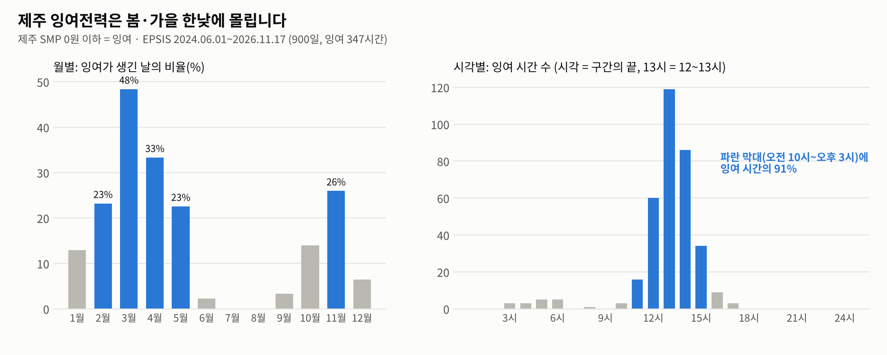
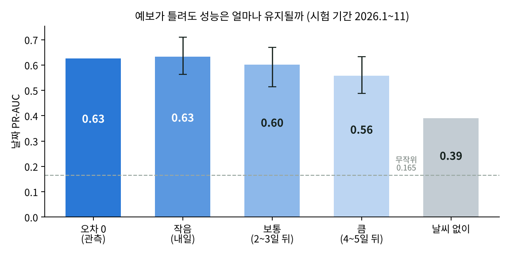
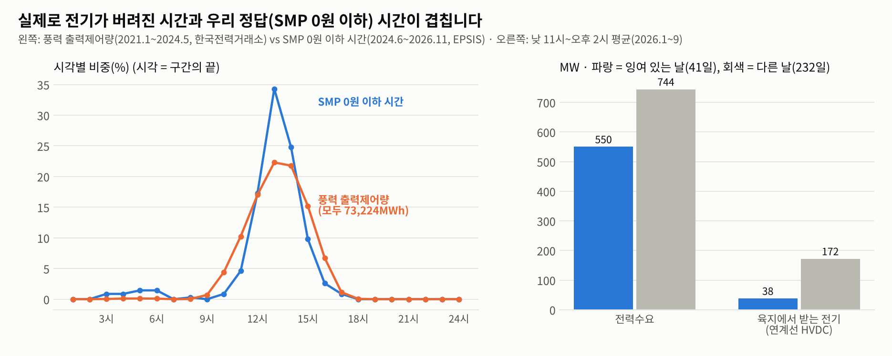

# 결과 설명자료 — 제주 잉여전력 도우미 (AI Agent)

> 제주 재생에너지가 남는 시간을 며칠 앞서 알려 주고, 도민이 그 시간에 전기를 쓰도록 돕는 AI Agent
> 작성 기준일: 2026-11-18 · 숫자는 모두 `reports/report.md`, `reports/metrics.json`, 도구 실행 결과에서 옮겼습니다.

---

## 1. 문제 정의

### 1-1. 무엇이 문제인가
- 제주는 태양광·풍력이 빠르게 늘었습니다. 허브 123 기준 태양광은 **1,998곳 711MW**로, 2018년 168MW에서 4배 넘게 늘었습니다. 허브 472 기준 풍력은 **25곳 419MW**입니다.
- 그래서 봄·가을 맑은 날 한낮에는 전기가 남아 **발전기 출력을 줄이는 출력제어**가 생깁니다.
  - 제주는 2023년 한 해 **181회** 출력제어를 했고, 2022년보다 약 37% 늘었습니다 (해줌, 벤처스퀘어 2024 보도).
  - 한국전력거래소 공개 기록으로 직접 세어 보면, 제주 **풍력**은 2021년 1월~2024년 5월에 **336일, 약 73,224MWh**를 출력제어로 버렸고(2023년 한 해 26,197MWh), **태양광**도 2021년 10월~2024년 6월에 125일 출력제어를 했습니다. 풍력 출력제어량의 93%가 오전 10시~오후 4시였습니다(팀원 B가 받은 공공데이터포털 15132422).
  - 2022년 9월~2024년 3월 제주 출력제어 분석에서는, 화력발전 최소출력을 낮추는 것만으로 줄일 수 있는 양이 누적 출력제어의 17%(약 5,800MWh)였습니다 (기후솔루션, 2025-10-31). 버려진 전기가 수만 MWh 규모라는 뜻입니다.
- 2024년 6월부터 제주에는 **재생에너지 입찰제도와 실시간시장**이 정식 시행됐습니다 (파이낸셜뉴스 2026-09-25). 그 뒤로는 강제 출력제어 대신 **가격으로 출력이 조정**되고, 전기가 남으면 제주 전력시장 가격(SMP)이 **0원 이하**로 떨어집니다. 이 서비스가 'SMP 0원 이하'를 잉여 신호로 쓰는 이유이고, 정답 데이터를 2024-06-01부터 쓰는 이유입니다.
- 2026년 3월에는 제주 전 지역의 계통관리변전소 지정이 해제되어, 새 재생에너지 발전소의 연결 검토가 다시 시작됐습니다 (메트로신문 2026-03-31). 앞으로 남는 시간은 더 늘어날 수 있습니다.
- 2024-06-01 ~ 2026-11-17(900일) 동안 제주 SMP가 0원 이하였던 시간은 **347시간(127일)**이었습니다.
  - 월별로 보면 **3월(전체 날의 48%)**, 4월(33%), 11월(26%)에 많고, **6~9월은 거의 없습니다**(0~3%).
  - 시간대로 보면 잉여 시간의 약 **91%가 오전 10시~오후 3시**에 몰립니다.



- 반대로 도민은 **남는 시간과 반대로** 전기를 씁니다. 허브 1226(2021.01~09, 130,042건)을 보면 제주 공용 충전기에서 충전을 가장 많이 시작하는 시각은 **16시**입니다.
  - 저녁 4~10시(계시별 요금의 최대부하 시간)에 시작한 충전이 **35%**입니다.
  - 잉여가 잘 생기는 오전 10시~오후 3시에 시작한 충전은 **34%**입니다.
  - 이 모양은 9개월 내내 거의 같습니다. 달마다 낮 충전과 저녁 충전이 모두 33~36% 사이이고, 가장 많은 시각은 9개월 중 7개월이 16시입니다. 잉여가 많은 봄(3~5월)에도 도민 충전은 낮으로 옮겨 가지 않았습니다.


### 1-2. 누구를 위한 것인가
| 사용자 | 얻는 것 |
|---|---|
| 제주 도민 (IT 비전문가, 어르신 포함) | "언제 빨래·충전하면 좋아?"에 쉬운 말로 답을 받음 |
| 전기차 운전자 | 잉여 시간 + 동네 충전소(급속 여부, 2022년 대기·관광객 비중)를 한 번에 확인 |
| 제주빅데이터센터 | 허브 데이터를 도민 행동과 연결하는 서비스 사례, 예보 기록을 쌓아 검증 가능 |

### 1-3. 솔직하게 밝히는 전제
- 일반(누진제) 가정은 **쓰는 시간만 옮겨서는 지금 당장 요금이 달라지지 않습니다.** 에이전트도 이렇게 답합니다.
- 금전 이득은 **계시별 선택요금제 가입 가구**(2021년 9월부터 선택 가능)와, 제주도가 추진 중인 **'제주형 전기요금제'가 시행된 뒤**에 생깁니다. 제주형 요금제는 아직 시행 전입니다.
- 그래서 이 서비스의 1차 목표는 **"버려지는 재생에너지를 줄이는 행동"을 쉽게 만드는 것**이고, 요금 이득은 조건이 맞을 때만 안내합니다.

---

## 2. 해결 방법 한눈에 보기


1. **정답 정의:** 제주 시간별 SMP가 0원 이하인 시간 = 잉여전력 시간
2. **예측:** 달력·최근 경향·날씨(관측/예보)로 앞으로 5일의 시간별 잉여 확률을 계산
3. **Agent:** 질문을 이해해 알맞은 도구를 부르고, 도구 결과에 있는 사실만으로 쉬운 말로 답함

---

## 3. Agent 구조

### 3-1. 처리 흐름 (Workflow)
1. **질문 받기:** 화면 대화창. 같은 대화의 최근 3번 질문·답변을 함께 넘겨 "그럼 거기는?"과 같은 이어지는 질문을 이해합니다.
2. **날짜 맥락 넣기:** 질문할 때마다 오늘 날짜, 이번 주·다음 주 범위, 예보 가능 범위(오늘~5일 뒤)를 지침에 넣습니다.
3. **도구 선택(LLM):** Gemini 3.5 Flash-Lite가 함수 호출(function calling)로 필요한 도구와 인자를 고릅니다. 예: 기간 → `start`·`days`. 한 질문에 최대 6단계까지 도구를 이어 부릅니다.
4. **도구 실행(코드):** 예측 모델과 허브·공공데이터를 읽어 JSON으로 돌려줍니다.
5. **답변 작성(LLM):** 도구 결과에 있는 숫자·날짜·장소만 써서 3~6문장으로 답하고, 출처를 한 줄로 붙입니다.
6. **근거 보기:** 화면에서 어떤 도구를 어떤 입력으로 불렀는지, 결과 표·그래프와 출처를 펼쳐 볼 수 있습니다.

### 3-2. 판단 및 자율 수행 범위
| Agent가 스스로 하는 것 | Agent가 하지 않는 것 |
|---|---|
| 질문에 맞는 도구 고르기, 여러 도구 이어 부르기 | 도구 결과에 없는 숫자·충전소·제도 만들기 |
| 기간 해석(오늘·이번 주·다음 주·요일·날짜) | 예보 범위(5일) 밖 날짜를 예보처럼 말하기 |
| 생활 언어에서 기기·때·배터리 % 알아내 시간·전력량 계산 | 사용자에게 kWh·kW를 묻기 |
| 저장한 내 정보(동네·차종·출퇴근)를 기본값으로 쓰기, 추천 시간대를 캘린더 일정으로 만들기 | 서버에서 알림 보내기·개인정보 저장 |
| 범위 밖·지난 날짜를 나눠서 설명 | 요금이 "자동으로 싸진다"고 단정하기 |
| 답할 수 없는 질문이면 할 수 있는 질문 예시 안내 | 결제·예약·기기 제어 같은 실제 행동 |

### 3-3. 안전장치
- **사실 목록(`facts.py`):** 요금제·정책 문장은 출처가 확인된 것만 씁니다. 에너지경제연구원, 공공데이터포털, 보도자료 등입니다.
- **주의 규칙:** "반드시·확실히" 같은 표현을 쓰지 않습니다. 예보는 확률이라고 알립니다.
- **비상 모드:** LLM 키가 없거나, 하루 한도를 넘었거나, 연결이 끊기면 **규칙 기반 답변으로 자동 전환**합니다. 이때도 같은 도구와 데이터를 씁니다.
- **예보 자동 갱신:** 앱을 열 때 저장된 단기예보가 4시간보다 오래됐으면 새로 받습니다. 실패하면 저장된 예보로 안내하고 화면에 알립니다.
- **키 보호:** 오류 메시지에 인증키가 찍히지 않게 처리했습니다. 키는 `.env`나 클라우드 Secrets에만 둡니다.

---

## 4. 주요 기능

### 4-1. 도구 11개
| 도구 | 하는 일 | 쓰는 데이터 |
|---|---|---|
| ① `forecast_surplus` | 오늘~5일 뒤 날짜·시간별 잉여 확률. 범위 밖은 "예보 불가" + 과거 같은 달 기록(참고) | EPSIS(정답), 기상청 단기예보, 허브 579(학습) |
| ② `recommend_actions` | 가전·전기차 충전 추천 시간 (요일·날짜 지정 가능) | ①, 계시별 요금 사실 |
| ③ `find_chargers` | 동네 주변 충전소 (거리, 급속·완속 수). **순서를 허브 데이터로 정함:** 가까운 곳 위주로, 낮(10~15시)에 붐볐던 곳(허브 1226)·대기가 잦았던 곳(허브 1225)은 뒤로 보내고 그 이유를 답에 말함 | **허브 862, 1226, 1225** |
| ④ `ev_charging_habits` | 도민 충전 시작 시각 vs 잉여 시간 비교 | **허브 1226**, EPSIS |
| ⑤ `explain_surplus` | 잉여가 언제·왜 생기는지 (월·시간·요일 통계, 일사·바람, 설비 증가) | EPSIS, **허브 877·123·472** |
| ⑥ `check_past_forecast` | 지난 예보가 맞았는지 비교 | 예보 기록 / 시험 기간 재현 예보, EPSIS |
| ⑦ `data_status` | 데이터 준비·실시간 예보 연결 상태 | 전체 |
| ⑧ `explain_benefits` | 도민이 얻는 것 / 얻지 못하는 것 (솔직하게) | 요금 사실, 허브 1226 |
| ⑨ `how_to_act` | 실천 방법 (예약 기능, 피할 시간, 요금제 문의처) | 요금 사실 |
| ⑩ `plan_appliance_use` | **생활 언어 이해:** "오늘 저녁에 세탁기 돌리려고", "차 배터리 반 남았어"처럼 kWh 없이 말해도 기기를 알아내 걸리는 시간·전력량을 계산하고, 남는 전기가 가장 많은 **연속 시간대**를 찾음. 원한 시간이 나쁘면 솔직히 말하고 대안 제시 | 기기 사전(`appliances.py`, 공인·제조사 자료), ① |
| ⑪ `grid_records` | 계통 기록: 버려진 재생에너지(풍력 출력제어 MWh, 태양광 출력제어 횟수), 잉여 날의 낮 전력수요·연계선(HVDC) 수전, 역송 시간, 플러스 DR 실적 | 한국전력거래소 공공데이터 4종 (팀원 B 수집) |

### 4-1-1. 허브 데이터가 답을 바꾸는 예 — 충전소 순서
"노형동 근처 급속 충전소 알려줘"라고 물으면 가까운 순서만 보는 대신, **허브 1226(2021년 1~9월 충전소별·시각별 충전 횟수)으로 각 충전소가 낮(10~15시)에 얼마나 붐볐는지**를 '한산·보통·붐빔'으로 나눠 순서에 반영합니다. 남는 전기 시간인 낮에 가도 자리가 있을 곳을 앞에 두기 위해서입니다.
- 계산: 2021년 낮 충전 횟수 ÷ **지금 충전기 수**(허브 862) → 급속이 있는 곳끼리, 완속만 있는 곳끼리 3등분
- 순서: 거리에 '보통 +0.25km, 붐빔 +0.5km, 대기 15% 이상(허브 1225) +0.3km'를 더한 값으로 정렬 (기록이 없으면 '보통')
- 예 (노형): 0.2km 노형동주민센터(급속 1대)는 낮에 붐볐던 곳(충전기 1대당 하루 3.9회꼴)이라 뒤로 가고, 0.1km 수덕공영주차장(낮에 한산, 1대당 0.2회꼴)이 첫 번째, 0.3km 웅전공영주차장(급속 12대, 한산)이 두 번째가 됩니다. 답에는 "노형동주민센터는 더 가깝지만 낮에 붐볐던 기록이 있어 뒤로 뺐어요"라고 이유를 말합니다.
- 화면의 근거 보기 표에도 '낮 이용(허브 1226)' 칸과 순서를 정한 방법이 나옵니다.

### 4-2. 기기 사전 — 도민은 kWh를 말하지 않는다
도민은 "30kWh 충전해야 해"라고 묻지 않습니다. "오늘 저녁에 세탁기 돌리려고", "차 배터리 반 남았어"처럼 말합니다.
그래서 에이전트가 기기 사전(`appliances.py`)으로 **걸리는 시간과 전력량을 대신 계산**합니다.

| 기기 | 1회 전력량 (대략) | 걸리는 시간 | 시간 옮기기 | 값의 근거 |
|---|---|---|---|---|
| 전기차 | 배터리 용량 × 채울 비율 (예: 64.8kWh 차 50%→80% = 약 19kWh) | 완속 7kW 기준 계산 | 높음 | 공인·제조사 |
| 세탁기 | 0.4~1kWh | 1시간~2시간 | 높음 | 공인·제조사 |
| 건조기 | 2~3.6kWh | 1시간 40분~3시간 10분 | 높음 | 공인·제조사 |
| 식기세척기 | 0.9~1kWh | 1시간 10분~2시간 | 높음 | 공인·제조사 |
| 히트펌프 | 집 크기·날씨·설정 온도마다 크게 달라 숫자로 말하지 않음 | 2시간~5시간 | 높음 | 공인·제조사 |
| 전기온수기 | 2~3kWh | 1시간~2시간 | 높음 | 계산값 |
| 전기보일러 | 제품 라벨 확인 | - | 보통 | 제품마다 다름 |
| 음식물처리기 | 1~2kWh | 3시간~4시간 | 높음 | 제품마다 다름 |
| 의류관리기 | 제품 라벨 확인 | 1시간 10분~1시간 30분 | 보통 | 공인·제조사 |
| 전기밥솥 | 제품 라벨 확인 | 30분~1시간 | 낮음 | 제품마다 다름 |
| 작은 충전기기 | 제품 라벨 확인 | - | 낮음 | 제품마다 다름 |
| 에어컨 | 1시간에 0.5~2.2kWh | - | 보통 | 공인·제조사 |
| 전기히터 | 제품 라벨 확인 | - | 낮음 | 제품마다 다름 |
| 전기장판 | 제품 라벨 확인 | - | 불가 | 제품마다 다름 |
| 보일러 | 먼저 "전기인가요, 기름·가스인가요?"를 물음. 기름·가스는 전기를 거의 안 씀 → 히트펌프 교체 지원 안내 | - | 불가 | 공인 자료(제주 도시가스 보급률·보급사업) |
| 냉장고·TV·조명 등 | 늘 켜 두거나 바로 써야 해 옮기지 않음 | - | 불가 | 기기 특성 |

- **연속 시간대 찾기:** 걸리는 시간(예: 건조기 4시간)만큼 연속으로 남는 전기 가능성이 가장 높은 때를 날짜마다 찾습니다. 오늘은 지금 시각 이후만 봅니다.
- **원한 시간이 나쁘면 솔직하게:** "오늘 저녁"처럼 남는 전기가 거의 없는 때를 말하면 먼저 그렇다고 말하고, 낮 시간대와 예약 기능을 권합니다. 계시별 요금 가구에는 밤 10시 이후가 저녁보다 싸다는 사실도 함께 알립니다.
- **필요한 것만 묻기:** 전기차는 배터리가 몇 % 남았는지만 묻습니다(모르면 반쯤으로 보고 계산한 뒤 알려 줌). 보일러는 전기인지 기름·가스인지 묻고, 기름·가스면 시간 이동 효과가 없다고 말한 뒤 제주도 히트펌프 교체 지원 사업을 안내합니다.
- **옮기기 어려운 기기:** 냉장고·전기장판처럼 시간을 옮길 수 없거나 효과가 작은 기기는 억지로 옮기라고 하지 않습니다.
- **일정 반영 (팀원 C의 '시간 제약 안에서 계획' 방식):** "9시 출근 6시 퇴근"이라고 하면 집에 없는 시간을 반영합니다. 예약 기능이 있는 세탁기·식기세척기는 집에 없어도 낮에 돌릴 수 있다고 알려 주고, 직접 켜야 하는 기기는 집에 있는 시간만 찾습니다. 전기차는 차가 사람과 함께 움직이므로 "회사·목적지 근처 충전소에서 낮에"와 "집에 있을 때"로 나눠 안내합니다.
- **숫자의 한계:** 값은 공인·제조사 자료의 대표 범위이고, 제품·코스·용량마다 다릅니다. 믿을 만한 대표값이 없는 기기는 숫자 대신 "제품 라벨 확인"을 안내합니다.

예시 (비상 모드 실제 출력, 2026-11-18 밤):
```
Q. 오늘 저녁에 세탁기 돌리려고
- 세탁기: 한 번에 약 1시간~2시간, 전기 약 0.4~1kWh 써요 (제품·코스마다 달라요).
- 원하신 때에는 제주에 남는 전기가 거의 없을 것 같아요.
- 저녁에는 제주에 남는 전기가 거의 없어요(잉여 시간의 약 91%가 오전 10시~오후 3시). 꼭 저녁에 써야 하면,
  계시별 요금제 가입 가구는 밤 10시 이후(경부하)가 저녁 4~10시보다 요금이 싸요.
- 세탁기 돌리기 좋은 때 (2시간 연속):
  · 11월 22일(일) 낮 12시~오후 2시 (가능성 보통 · 날씨 미반영 참고치)
  · 11월 21일(토) 낮 12시~오후 2시 (가능성 낮음)
- 세탁기 '예약' 기능으로 끝나는 시간을 맞춰 두면 편해요.
```

### 4-3. 화면
한 화면에서 스크롤 없이 예보·지도·대화를 함께 보도록(지도 높이가 화면 높이에 맞춰 늘고 줄어듦) **왼쪽 = 예보와 지도, 오른쪽 = 에너지 도우미(대화)**로 나눴습니다(팀원 화면 개편, `app.py`·`dashboard_view.py`).

**왼쪽: 예보와 지도**
- **5일 예보 카드:** 날짜별 등급(높음·보통·낮음)과 최고 가능성(%), 가능성 있는 시간대
- **지도 3종 (버튼으로 전환)**
  - **⚡ 잉여 예보 지도 (카카오맵):** 제주를 8개 권역으로 나눠 원 크기 = 권역의 재생에너지 설비용량(허브 123 태양광 사업장 + 풍력발전현황), 원 색 = 고른 시각의 잉여 가능성으로 그립니다. 제주는 전력망이 하나라 잉여도 섬 전체에서 같은 시각에 생기므로 **색은 섬 전체 예보 한 값**이고, 지역별 예보로 오해하지 않도록 지도 위에 "섬 전체 잉여 가능성 ○%"와 그 이유를 적어 둡니다. 급속 충전소(허브 862)와 풍력발전소도 함께 보입니다.
  - **📍 내 주변 충전소 (GPS):** '내 위치로 찾기'를 누르면 브라우저가 위치 허용을 묻고, 허용하면 지금 위치와 가까운 충전소 5곳을 거리순으로 보여 줍니다(배경 **카카오맵**, 키가 없거나 실패하면 OpenStreetMap). 위치는 **브라우저 안에서만 계산하고 서버로 보내거나 저장하지 않습니다.** 위치를 거부했거나 **제주 밖**(예: 육지에서 시연)이면 지도 위에 **빨간 안내**("GPS로 위치는 확인했어요. 지금은 제주에서 약 337km…")를 띄우고 '내 정보'에 저장한 동네 기준으로 보여 줍니다. 충전소마다 **'여기까지 길찾기'**(카카오맵이 현재 위치에서 길 안내)가 붙습니다. 급속은 파란 점, 완속은 보라 고리로 모양부터 다르고, '급속만 보기'를 켜면 버튼이 초록으로 바뀌며 지도 범례에 '지금: 급속만 보는 중'이 나옵니다.
  - **🔌 충전소 전체:** 공용 충전소 3,048곳(급속 1,160곳은 파랑)과 풍력발전소 25곳(원 크기 = 설비용량)을 한 지도에 표시합니다(팀원 B의 지도 아이디어). 충전소가 많은 곳은 숫자 원으로 묶이고, 점을 누르면 이름과 길찾기가 나옵니다.
- **시각 슬라이더 + 시간별 그래프 (지도 아래, 늘 보임):** 슬라이더 손잡이 위에 "12~13시 · 전기가 남을 가능성 35% (보통)"처럼 고른 시각의 값이 나오고, 앞으로 5일의 시간별 가능성을 막대로 보여 주며(밤은 회색 배경, 20%·50% 기준선), 슬라이더로 시각을 고르면 잉여 예보 지도의 색이 바뀝니다. 아래에 **추천 시간대(3시간) 3개**를 표시합니다.

**오른쪽: 에너지 도우미**
- **빠른 질문 4개:** "이번 주 언제가 좋아?", "전기차 충전", "왜 생기는 거야?", "지난 예보 맞았어?"
- **🏝️ 허브 배지:** 답마다 "이 답에 쓰인 제주데이터허브: 862 · 1226 · 1225"처럼 실제로 쓴 허브 데이터 번호를 보여 줍니다.
- **대화창 + 근거 보기:** 사용한 도구·입력·출처, 그래프(월별 잉여일 비율, 충전 시각 비교, 시각별 출력제어량), 찾은 충전소 지도(카카오맵)·표, 기기별 추천 시간대 표와 계산식
- **📅 캘린더에 넣기 (알림):** 기기·충전 시간을 추천하면 답 아래에 '구글 캘린더'(안드로이드·PC)와 '아이폰·아웃룩(.ics)' 버튼이 나옵니다. 추천 시간대가 일정으로 저장되고 **10분 전에 휴대폰 알림**이 옵니다. 서버가 알림을 보내지 않고 사용자의 캘린더가 알려 주므로, 개인정보를 서버에 남기지 않습니다.

**👤 내 정보 (오른쪽 에너지 도우미 맨 위)**
- 대화창 바로 위에 `👤 노형 · 아이오닉5 · 평일 9~18시 ✎ 바꾸기`처럼 한 줄로 보이고, 누르면 입력 창이 열립니다. 왼쪽 사이드바(▸)에도 같은 입력 칸이 있어 어느 쪽에서 저장해도 같습니다(사이드바는 휴대폰에서 접혀 있어 늘 보이는 자리에도 둠).
- 사는 동네, 전기차 차종, 평일 출근·퇴근 시각, 계시별 요금제 가입 여부를 한 번 넣으면 이후 질문의 기본값이 됩니다. "충전소 어디 있어?"만 물어도 내 동네로, "충전 언제 해?"만 물어도 내 차·출퇴근에 맞춰 계산합니다. 질문에 다른 값을 말하면 그게 우선입니다. 내 정보는 페이지 주소에 담기므로 즐겨찾기하면 다음에도 그대로 불러옵니다. 이름·연락처는 받지 않습니다.

**사이드바(왼쪽 위 ▸)**
- **데이터·AI 상태:** 데이터 준비 상태, AI 연결 상태, 기상청 예보 발표 시각(머리말에도 표시)

시간은 "낮 12시~오후 2시"처럼 말하고, 지도·그래프의 시각 표기는 정답 데이터(SMP)의 '구간 끝' 표기를 '구간 시작~끝'으로 바꿔 보여 줍니다(예: 13시 값 = 12~13시).


---

## 5. 실행 결과

### 5-1. 예측 성능 (2026-01-01 ~ 2026-11-17, 학습에 쓰지 않은 기간)
시험 기간 320일 중 잉여가 생긴 날은 53일(16.5%), 잉여 시간은 133시간입니다.

| 방법 | 날짜 PR-AUC | 날짜 정밀도 | 날짜 재현율 | 시간 PR-AUC |
|---|---|---|---|---|
| 기준선: 단순 규칙 (6~9월 제외 12~14시) | 0.253 | 0.256 | 0.962 | 0.163 |
| 기준선: 과거 비율 (월·시각·휴일) | 0.322 | 0.329 | 0.491 | 0.239 |
| 1차 모델 (달력·최근 경향) · 고정 학습 | 0.390 | 0.400 | 0.377 | 0.256 |
| **날씨 모델 (+기상청·허브 579) · 고정 학습** | **0.624** | **0.675** | 0.509 | **0.521** |
| **날씨 모델 · 월별 재학습** | **0.651** | 0.653 | **0.604** | **0.568** |


- 무작위로 찍으면 날짜 정밀도는 0.165입니다. 날씨 모델은 이보다 **약 4배** 정확합니다.
- 날씨를 넣자 날짜 PR-AUC가 0.390 → 0.624로 올랐습니다. 모델은 **HistGradientBoosting**(scikit-learn)이고, CPU로 1분 안에 학습합니다.
- 월별로 보면 봄(2~5월)에 강하고, **9~10월은 약합니다.** 실제 잉여일의 평균 예측확률이 9월 0.01, 10월 0.22였습니다.

#### 예보가 틀리면 성능은 얼마나 떨어지나 (예보 날씨 오차 시험, `python experiments/forecast_error_test.py`)
위 성능은 **실제로 관측된 날씨**를 넣고 잰 값입니다. 서비스에서는 틀릴 수 있는 **기상청 예보 날씨**를 넣으므로, 과거 예보 기록이 없는 대신 시험 기간의 관측 날씨에 **예보만큼의 오차를 일부러 섞어** 다시 채점했습니다. 학습은 관측 날씨 그대로 두고(서비스와 같음), 오차는 하루 단위로 같은 방향으로 틀리게 넣었습니다. 단계마다 20번 반복한 평균입니다.

| 넣은 날씨 | 날짜 PR-AUC (20번 중 최소~최대) | 오차 없을 때 대비 |
|---|---|---|
| 관측 날씨 그대로 (오차 없음) | 0.627 | 100% |
| 오차 작음 (내일 예보 수준: 기온 ±1.0℃, 하늘 15%·비 8%의 날 틀림) | 0.634 (0.563~0.710) | 101% |
| 오차 보통 (2~3일 뒤 수준: 기온 ±1.5℃, 하늘 30%·비 15%의 날 틀림) | 0.601 (0.513~0.669) | 96% |
| 오차 큼 (4~5일 뒤 수준: 기온 ±2.0℃, 하늘 45%·비 25%의 날 틀림) | 0.557 (0.488~0.632) | 89% |
| 날씨 없이 (달력·최근 경향만) | 0.390 | 62% |



- **보통 수준의 예보 오차에서도 성능의 약 96%(0.60)를 유지**했고, 오차가 큰 경우에도 89%(0.56)로 날씨 없는 모델(0.39)보다 높았습니다. 오차가 작을 때 0.634로 조금 오른 것은 우연한 흔들림 범위 안입니다.
- 기온 오차는 기상청 '월별 예보평가'의 최고기온 예보 평균절대오차(1.0~1.7℃, 2025년 10월~2026년 9월, 전국)에 맞췄습니다. 풍속·하늘상태·비 오차는 공개 수치를 찾지 못해 **가정한 값**입니다. 숫자 전체는 `reports/forecast_error_test.md`에 있습니다.
- 이 시험의 '오차 없음' 값(0.627)은 같은 방법으로 다시 학습한 값이라 표의 0.624와 소수 셋째 자리가 조금 다릅니다(실행 환경 차이).
- 실제 서비스에서 단기예보가 하루 오후를 덮는 것은 1~2일 뒤까지입니다(위 표의 '작음~보통').

#### 3~5일 뒤는 중기예보로 (중기 모델)
단기예보가 없는 3~5일 뒤는 처음에 날씨 없이 계산한 참고치(0.39)였습니다. 그래서 기상청 **중기예보**(제주도, 하루 2번 발표)가 주는 값만 쓰는 **중기 모델**을 따로 만들었습니다. 중기예보에는 오전·오후 하늘상태, 강수확률, 최고기온만 있어서, 학습할 때도 관측 날씨를 같은 모양(오후 하늘 3단계, 오후 비 여부, 최고기온)으로 줄여 썼습니다.

| 3~5일 뒤 예보에 쓰는 모델 | 날짜 PR-AUC | 시간 PR-AUC |
|---|---|---|
| 처음: 날씨 없이 (달력·최근 경향) | 0.390 | 0.256 |
| 중기 모델, 관측 날씨로 잼 (고정 학습) | 0.607 | 0.429 |
| **중기 모델, 4~5일 뒤 수준의 큰 오차를 넣었을 때** (20번 평균, 최소~최대 0.460~0.568) | **0.524** | 0.356 |

- 큰 예보 오차를 넣어도 0.52로, 날씨 없이 낸 참고치(0.39)보다 약 **34% 높습니다**. 시간 단위는 여전히 약해서, 3~5일 뒤는 "그날 가능성"을 보는 용도로 씁니다.
- 3일 뒤(글피)는 단기예보가 3시간 간격으로만 있어 같은 중기 모델에 단기예보 값을 줄여 넣고, 4~5일 뒤는 기상청 중기예보 값을 넣습니다. 2026-11-19 실제 중기예보(06시 발표, 7일치)로 받아 예측까지 되는 것을 확인했습니다.
- 화면과 답에는 근거를 '기상청 중기예보 반영(거침)'으로 따로 밝힙니다. 중기예보를 받지 못하면(활용신청 전, 연결 실패) 예전처럼 참고치로 돌아갑니다.
- 다시 만들기: `python experiments/add_mid_model.py`(중기 모델만 기존 모델 묶음에 추가), `python collect_weather.py mid`(중기예보 받기)
- 실제 예보 성적은 화면이 낸 예보를 `data/forecast_log.csv`에 2026-11-19부터 쌓고, '지난 예보 맞았어?' 질문(도구 ⑥)이 이 기록을 먼저 써서 확인합니다.

### 5-2. AI(LLM) 모드 시험 (`python run_llm_eval.py`)
실제 Gemini로 질문 27개를 자동으로 묻고 채점했습니다. 질문에는 이어지는 대화 4개, 함정 질문 4개, 생활 언어 기기 질문 6개(출근 일정 포함), 계통 기록 질문 1개, 저장한 내 정보로 답하기 1개가 들어 있습니다.
채점 기준은 ① 맞는 도구를 불렀는지, ② 정직하게 답했는지(꼭 들어갈 말이 있는지, 지어낸 숫자가 없는지)입니다.

<!--LLM_EVAL_TABLE-->
**결과: 27/27 통과** (2026-11-19 12시 14분, `gemini-3.5-flash-lite`, 27문항 모두 LLM이 직접 답함, 전체 답변은 `reports/llm_eval.md`)

| 분류 | 문항 | 통과 | 확인한 것 |
|---|---|---|---|
| 예보·기간 해석 | 3 | 3 | '이번 주'·'다음 주 화요일'·'오늘 오후'를 날짜로 바꾸고, 지난 날은 예보하지 않음 |
| 함정·정직성 | 4 | 4 | 예보 범위 밖(12월 25일)은 예보하지 않고 과거 비율만 안내, 일반 가정은 요금이 바로 싸지지 않는다고 말함, 없는 충전 요금을 지어내지 않음, 범위 밖 질문(맛집)은 거절 |
| 충전소 | 2 | 2 | 동네 이름으로 가까운 충전소와 거리 |
| 설명 | 4 | 4 | 잉여 원인, 태양광 설비 710.9MW(허브 123), 계시별 요금 시간대, 풍력 출력제어 73,224MWh |
| 데이터 | 3 | 3 | 도민 충전 시각(허브 1226), 지난주 예보 검증, 데이터 출처 |
| 생활 언어 기기 | 6 | 6 | kWh를 묻지 않고 기기 사전으로 계산, 저녁 사용은 솔직히 '낮음'이라 말하고 더 나은 때·예약 기능 안내, 보일러는 연료부터 물음, 냉장고는 옮기지 말라고 함, 출근 일정 반영 |
| 내 정보 | 1 | 1 | "충전소 어디 있어?"만 물어도 저장한 동네(노형)로 찾음 |
| 이어지는 대화 | 4 | 4 | "거기 중에 급속만", "한 줄로 정리해줘", "그렇게 하려면?", "기름 보일러야"(→ 히트펌프 지원 안내) |

- 같은 시험의 이전 결과(2026-11-19 0시, 24문항)는 20/24였습니다. 틀린 4문항(태양광 질문 거절, 도구 인자 오류, 응답 지연, 지어낸 출처)을 고친 뒤 문항을 27개로 늘려 다시 시험했습니다.
- LLM 답은 매번 조금씩 달라질 수 있어 한 번의 결과입니다. 사소한 차이도 있었습니다. 예를 들어 G01에서 출력제어 시간대를 "낮 11시~오후 4시"라고 했는데, 도구 결과는 "오전 10시~오후 4시에 93%"입니다.
<!--/LLM_EVAL_TABLE-->

### 5-3. 비상 모드(규칙 기반) 시험 (`python run_scenarios.py`)
| 시험 | 결과 |
|---|---|
| 대표 시나리오 5개 (일반 가정 / 전기차 도민 / 원인 설명 / 예보 검증 / 데이터 상태) | 5/5 통과 |
| 질문 이해 (오타·사투리·생활 언어·출근 일정·계통 기록·답할 수 없는 질문 포함) | 58/58 통과 |
| 이어지는 질문 이해 ("그렇게 하려면 어떻게 해야 해?", 보일러 "기름이야", 배터리 "30퍼 남았어" 등) | 8/8 통과 |
| 생활 언어 답변 (계산값·정직성: 저녁엔 남는 전기가 없다고 말하기, 예보 범위 밖 날짜, 옮기기 어려운 기기, 출근 일정, 충전소 거리) | 10/10 통과 |
| **pytest 자동 시험** (위 시험 + 도구·데이터·오류 처리·키 검사, `python -m pytest`) | **135/135 통과** |

LLM 키가 없거나 하루 한도를 넘었을 때도 같은 도구로 답할 수 있는지 확인하는 시험입니다.

### 5-4. 실제 답변 예시 (Gemini)
<!--LLM_EXAMPLES-->
아래는 위 시험에서 나온 실제 답변을 그대로 옮긴 것입니다(출처 줄 일부 생략).

**① 생활 언어 — "오늘 저녁에 세탁기 돌리려고"** (도구: `plan_appliance_use`)
> 오늘 저녁 시간대에는 재생에너지가 남을 가능성이 낮아요. 세탁기는 대략 1시간~2시간 동안 0.4kWh~1.0kWh 정도의 전기를 쓰지만, 제품이나 코스에 따라 달라져요. 대신 일요일 낮 12시~오후 2시는 가능성이 '보통'이라 그때 쓰시는 게 더 나아요. 세탁기의 '예약' 기능을 쓰시면 편리합니다.

**② 예보 범위 밖 — "12월 25일 크리스마스에도 전기 남아?"** (도구: `forecast_surplus`)
> 12월 25일은 아직 예보할 수 있는 기간이 아니어서 예보할 수 없어요. 다만 과거 12월의 기록을 보면, 같은 달 전체 날짜 중 잉여전력이 생긴 날의 비율은 6.5%였어요. 예보는 보통 오늘부터 5일 뒤까지만 미리 알려드릴 수 있답니다.

**③ 저장한 내 정보 — "충전소 어디 있어?"** (내 정보: 노형·아이오닉5, 도구: `find_chargers`)
> 저장한 내 정보(노형) 기준 가까운 전기차 충전소를 알려드려요. 1. 수덕공영주차장 (급속 4기, 0.09km) 2. 노형 제5 공영주차장 (급속 4기, 0.2km) 3. 노형동주민센터 (급속 1기, 0.22km) … 답 아래 '근거 보기' 표의 '내 위치에서 길찾기'를 누르면 카카오맵이 지금 위치에서 길을 안내해요.

**④ 이어지는 대화 — "보일러 언제 틀면 좋아?" → "기름 보일러야"** (도구: `plan_appliance_use` → 대화 맥락)
> 기름 보일러는 전기를 쓰지 않아 남는 재생에너지를 활용해 시간을 옮겨 틀기는 어려워요. 다만 기름·가스 보일러를 쓰신다면 제주도의 '생활 속 히트펌프 보급사업'을 통해 친환경 히트펌프 보조금 지원을 신청하실 수 있습니다.
<!--/LLM_EXAMPLES-->

---

## 6. 검증 방법

1. **시간 순서 검증:** 2026년 전체를 학습에서 빼고 시험했습니다. '월별 재학습'은 각 달 시작 5일 전까지의 데이터만 씁니다.
2. **미래 정보 차단:** '최근 경향' 변수는 예보 시점에 알 수 있는 값(5일 이상 지난 값)만 씁니다.
3. **기준선 비교:** 단순 규칙과 과거 비율보다 나은지 같은 기간에서 비교했습니다.
4. **정답 원자료 확인:** EPSIS 원자료(900일)와 요약본의 잉여 시간이 일치하는지 대조했습니다(불일치 0건).
5. **정답이 실제 '버려지는 전기'와 맞는지 확인 (팀원 B 데이터):** 'SMP 0원 이하'는 우리가 고른 잉여 신호입니다. 이것이 실제 전력 계통 상황과 맞는지 한국전력거래소 기록과 비교했습니다.
   - 시각별 분포: 풍력 출력제어량(2021~2024.5)과 SMP 0원 이하 시간(2024.6~)이 모두 **낮 12~14시에 정점**인 같은 모양입니다.
   - 같은 시각 비교(2026.1~9): 잉여가 생긴 날의 낮 11시~오후 2시 전력수요는 평균 **550MW**로 다른 날(744MW)보다 적었고, 육지에서 받는 전기(연계선 HVDC)도 **38MW**로 다른 날(172MW)의 4분의 1이었습니다.
   - 같은 기간 제주가 육지로 전기를 보낸(역송) 시간은 226시간으로, 그중 SMP 0원 이하는 43시간이었습니다. 즉 SMP 0원 이하는 **확실히 남는 시간만 잡는 보수적인 신호**이고, 실제로 남는 시간은 이보다 더 많을 수 있습니다.



6. **예보 기록:** 에이전트가 낸 예보를 `data/forecast_log.csv`에 쌓아, 날짜가 지나면 실제 SMP와 비교합니다(도구 ⑥).
7. **Agent 시험:** 시나리오·질문 시험을 코드로 자동화했습니다(`run_scenarios.py`). 바꿀 때마다 다시 돌립니다.
8. **pytest 자동 시험 135개 (팀원 C의 pytest 방식):** `python -m pytest` 한 줄로 키·인터넷 없이 수 초 안에 다시 확인할 수 있습니다. 정답 숫자, 예보 범위 밖 거절, 기기 계산, 충전소 찾기, 계통 기록 숫자, 내 정보 기본값과 질문 우선 규칙, 캘린더 파일(10분 전 알림·줄 길이 규칙), LLM 오류 시 재시도·규칙 기반 전환·키 가림, 소스에 키가 없는지까지 검사합니다(`tests/`).

---

## 7. 기대효과

### 7-1. 숫자로 본 효과 (시나리오 추정)
"잉여가 생기는 날, 도민이 전기 쓰는 시간을 낮으로 옮기면 얼마나 쓸 수 있나"를 **가정 기기**와 **전기차** 두 갈래로 나눠 계산했습니다. 참여율은 예측이 아니라 **가정한 시나리오**입니다.

**계산에 쓴 값**

| 값 | 숫자 | 출처 |
|---|---|---|
| 가정 1곳이 잉여일에 옮기는 전기 | 1.65 kWh (세탁기 1회 0.7 + 식기세척기 1회 0.95) | 기기 사전(`appliances.py`, 한국에너지공단·제조사 자료)의 중간값 |
| 전기차 충전 1회 | 17.2 kWh | 허브 1226: 공용 충전 9,913 MWh ÷ 577,303회 (2021년 1~9월) |
| 제주 전기차 | 약 42,400대 (2025년 8월, 보급률 10.24%) | Korea Business Review(2026-04) 인용 통계 |
| 잉여가 생기는 날 | 연 약 52일 | EPSIS: 지난 900일 중 127일 |
| 풍력 출력제어가 있던 날 하루 평균 버려진 양 | 약 218 MWh | 한국전력거래소: 336일, 73,224 MWh (2021.1~2024.5, 팀원 B 수집) |

**시나리오 (잉여일 하루 기준)**

| 시나리오 | 가정 기기 | 전기차 (하루 1회 충전을 낮으로) | 합계 | 버려진 풍력 하루 평균(218 MWh) 대비 | 연간 (52일) |
|---|---|---|---|---|---|
| 작게: 1만 가구 + 전기차 5% | 16.5 MWh | 36.4 MWh | **53 MWh** | 약 24% | 약 2,800 MWh |
| 보통: 3만 가구 + 전기차 10% | 49.5 MWh | 72.8 MWh | **122 MWh** | 약 56% | 약 6,400 MWh |
| 크게: 5만 가구 + 전기차 20% | 82.5 MWh | 145.6 MWh | **228 MWh** | 약 105% | 약 11,900 MWh |

- **보통 시나리오면 잉여일마다 버려지는 풍력의 절반 정도를 도민 생활에서 쓸 수 있는 규모**입니다. 연간 약 6,400 MWh는 2023년 한 해 풍력 출력제어량(26,197 MWh)의 약 4분의 1입니다.
- 공용 충전만 따로 보면(허브 1226), 잉여일에 저녁 충전(하루 평균 12.9 MWh)의 10%를 옮길 때 연 약 67 MWh입니다. 집 충전과 가정 기기를 더해야 의미 있는 규모가 된다는 뜻이고, 그래서 이 서비스는 충전소 안내뿐 아니라 **생활 기기**까지 다룹니다.
- **솔직한 한계:**
  - 참여율(가구 수, 전기차 비율)은 가정입니다.
  - 버려진 양 218 MWh는 풍력만의 값입니다. 태양광 출력제어량(MWh)은 공개 자료에 없어 빠졌으므로 실제 비율은 이보다 낮습니다.
  - 옮긴 전기만큼 출력제어가 그대로 줄어드는지는 계통 운영에 달려 있어 보장할 수 없습니다.
  - 전기차 대수는 공식 통계를 인용한 기사 숫자입니다.

### 7-2. 숫자로 보기 어려운 효과
- **도민:** "언제 쓰면 좋아?"를 쉬운 말로 바로 확인합니다. 계시별 요금 가입 가구는 저녁 사용을 줄여 요금을 아낄 수 있습니다.
- **정책:** 제주형 전기요금제가 시행되면 같은 화면이 곧바로 '돈이 되는 시간' 안내가 됩니다.
- **센터:** 허브 데이터(충전·기상·설비)가 도민의 실제 행동 안내로 이어지는 사례가 됩니다.

---

## 8. 한계 (꼭 함께 읽어 주세요)

| 한계 | 내용 | 대응 |
|---|---|---|
| **성능은 '관측 날씨' 기준** | 5-1의 날씨 모델 성능은 실제로 관측된 날씨를 넣고 잰 값입니다. 과거 단기예보 기록을 구할 수 없어 **실제 예보로 잰 성능은 아직 없습니다.** 대신 예보만큼의 오차를 섞은 시험에서 보통 오차일 때 0.60(관측 대비 96%), 큰 오차일 때 0.56(89%)이었습니다. 풍속·하늘·비 오차 크기는 가정값입니다. | 화면이 낸 예보를 2026-11-19부터 쌓아 실제 성적을 확인합니다(도구 ⑥). |
| 날씨 반영 기간 | 기상청 단기예보는 약 2~3일 앞까지만 있습니다. 3~5일 뒤는 중기예보(오후 하늘·비·최고기온)만 있어 덜 정확합니다(큰 오차 시험 0.52). | 화면과 답변에 근거를 "단기예보 반영 / 중기예보 반영(거침) / 날씨 미반영 참고치"로 나눠 표시합니다. |
| 허브 579 기간 | 허브 579 일별 기상은 **2025-03-30까지**만 있습니다. 그 뒤 학습·시험 기간은 기상청 ASOS 관측으로 같은 형태의 값을 만들어 채웠습니다. | 데이터 활용 명세서에 처리 방법을 적었습니다. |
| 충전 데이터가 오래됨 | 허브 1226은 2021년 1~9월(하루 호출 한도 때문에 18개월 중 9개월 수집), 1225는 2022년 7~10월(충전소 17곳)입니다. 충전소 순서를 정하는 '낮 이용 정도'도 이 기록이라, 그 뒤 생긴 충전소는 기록이 없어 '보통'으로 봅니다. | 2021년 낮 충전 횟수를 **지금 충전기 수**(허브 862)로 나눠 충전기를 늘린 곳이 불리하지 않게 했고, 답변에 "2021년 기록"이라고 기간을 붙입니다. |
| 가을 성능 약함 | 9~10월 잉여는 잘 맞히지 못합니다. | 확률로만 안내하고 단정하지 않습니다. |
| 요금 이득 제한 | 일반 가정은 지금 요금 변화가 없습니다. | 에이전트가 솔직하게 안내합니다(도구 ⑧). |
| 충전소 실시간 상태 없음 | 지금 비어 있는지, 고장인지는 알 수 없습니다. | 위치·급속 여부·과거 혼잡만 안내합니다. |
| LLM 무료 한도 | Gemini 무료 등급은 하루 500회입니다(질문 1개에 약 2~4회 사용). | 한도를 넘으면 규칙 기반으로 자동 전환합니다. |
| LLM 오류 가능성 | LLM은 도구 결과를 잘못 요약할 수 있습니다. | 숫자는 도구 결과만 쓰게 하고, '근거 보기'로 원래 값을 확인할 수 있게 했습니다. |

---

## 9. 제주빅데이터센터 활용 방안

1. **센터 PC에서 바로 실행:** GPU가 필요 없고(CPU 1분 학습), 더블클릭 실행 파일(`실행하기.bat`)이 있습니다. 데이터·모델이 들어 있어 키 없이도 화면과 대화(비상 모드)가 동작합니다.
2. **'탐라는 전기예보제'·전력예측 플랫폼과 연계:** 제주도는 2027년 전력정보 AI 예측 통합 플랫폼 구축을 구상하고 있습니다(파이낸셜뉴스 2026-10-09). 이 에이전트의 예보 도구와 예보 기록은 그 시범·검증 자료로 쓸 수 있습니다.
3. **제주형 전기요금제 시행 대비:** 요금제가 시행되면 `facts.py`의 사실 한 줄과 추천 문구만 바꾸면, 잉여 시간 사용이 곧 금전 이득이 되는 안내로 바로 전환됩니다.
4. **허브 데이터 갱신 시 자동 반영:** 허브 862·1225·1226이 최신 데이터로 갱신되면 `collect_hub.py`로 다시 받기만 하면 됩니다. 코드 수정은 필요 없습니다.
5. **확장:** 같은 구조로 '잉여 시간 공공시설 충전 할인', 'V2G·ESS 충전 계획' 같은 정책 시뮬레이션 도구를 추가할 수 있습니다.

---

## 10. 재현 방법
- 설치·실행: `docs/manual.md`
- 데이터 출처·전처리: `docs/data_spec.md`
- AI·외부 API·오픈소스 고지: `docs/ai_disclosure.md`
- 성능 다시 계산: `python train.py` → `reports/report.md`
- Agent 시험: `python run_scenarios.py` → `reports/scenario_results.md`

## 참고 자료
- 전력거래소 EPSIS 제주 시간별 SMP / 공공데이터포털 「한국전력거래소_제주 일별 시간별 SMP 정보」(15150712)
- 제주데이터허브 579·862·1225·1226·877·123·472
- 기상청 API허브 지상관측(ASOS), 공공데이터포털 「기상청_단기예보 조회서비스」(15084084)·「기상청_중기예보 조회서비스」
- 에너지경제연구원 이슈페이퍼 23-10 (2023) — 제주 주택용 계시별 선택요금제
- 뉴시스 2026-09-16 — 제주형 전기요금제 추진 / 파이낸셜뉴스 2026-10-09 — 전력정보 AI 예측 통합 플랫폼 구상
- 파이낸셜뉴스 2026-09-25 — 제주 실시간시장·재생에너지 입찰제도 2024년 6월 시행
- 기후솔루션 「제주 출력제어 사례로 본 최소발전용량 하향 조정의 편익」 (2025-10-31)
- 벤처스퀘어 (2024) — 해줌, 제주 2023년 출력제어 181회
- 메트로신문 2026-03-31 — 제주 계통관리변전소 지정 해제
- 산업통상자원부 보도참고자료 2020-12-17 — 주택용 4인 가구 월평균 350kWh
- 한국에너지공단 효율등급 자료(드럼세탁기 1등급 기준 45.8Wh/kg, 세탁건조기 1회 세탁 432.3Wh, 20kg 건조기 1회 1,989.1Wh) — 삼성전자 뉴스룸 인용
- 한국소비자원 비교시험 — 건조기 1회 1시간 43분~3시간 6분, 식기세척기 표준코스 1시간 6분~2시간, 의류관리기 1시간 7분~1시간 30분
- 삼성전자·LG전자 제품 표시값 — 식기세척기 12인용 표준코스 0.97·1.0kWh, 에어컨 정격 냉방 소비전력(벽걸이 510W, 스탠드 2,200W)
- 현대자동차·기아 공개 자료 — 배터리 용량(레이EV 35.2, 니로EV·코나 64.8, 아이오닉5·EV6 84.0kWh)
- 한국냉난방공조신문 — 제주 생활 속 히트펌프 보급사업(20kW 미만 히트펌프 + 축열조 300~500L)
- 서울신문 2026-03-12 — 제주 도시가스 보급률 18.5%
- 기상청 날씨누리 「월별 예보평가」 — 최고기온 예보 평균절대오차 1.0~1.7℃ (2025.10~2026.9, 전국)
- Korea Business Review (2026-04-02) — 제주 전기차 42,381대·보급률 10.24% (2025년 8월)
